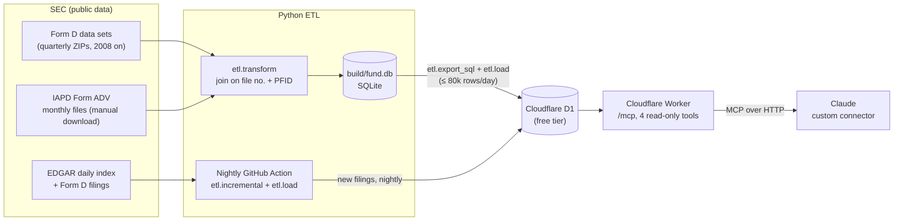

# private-fund-mcp

A free, open-source [MCP](https://modelcontextprotocol.io) server that lets Claude answer questions about venture capital and private equity funds, and the firms that manage them, from public SEC filings. It runs on Cloudflare's free tier for **$0 a month**.

> Data from public SEC filings as filed. Not investment advice. Fund returns are not in these filings.

## In plain English

When a US private fund starts raising money, it files a short notice with the SEC called a **Form D**: who the fund is, how much it hopes to raise, how much it has sold so far and to how many investors. Separately, the investment firm that manages the fund files a **Form ADV** every year, and its Schedule D lists each private fund it runs: the fund's type, its gross assets, how many owners it has, its auditor and, crucially, the fund's Form D file number.

Both filings are public, but they live in different SEC systems and nobody joins them for you. This project downloads both, links each fund to its Form D filings **by ID** (the Form D file number and the private fund ID, never by name), and serves the result to Claude as four read-only tools. So you can ask "what funds does this firm manage and how big are they?", "how much did this fund raise?", or "which new VC funds launched in Connecticut last month?", and Claude answers with the numbers and a link to the filing behind each one.

## Use it in Claude

1. In Claude, open **Settings → Connectors → Add custom connector**.
2. Paste the server URL:

   ```
   https://private-fund-mcp.<subdomain>.workers.dev/mcp
   ```

   <!-- TODO after `wrangler deploy`: replace with the deployed URL. -->
   The public URL goes here once the Worker is deployed (after the initial data load finishes, see [Operations](#operations)). No sign-in is needed: every tool is read-only.
3. Start a new chat and ask, for example:
   - *"What funds does Weathergage Capital manage, and what are they worth in total?"*
   - *"Which new venture capital funds filed a Form D in Connecticut in August 2026? Who's behind them?"*
   - *"How much has Coller International Partners IX raised according to its Form D filings?"*

Every answer comes with its sources (EDGAR accession numbers or the adviser's IAPD page), the date the data is current to, and notes such as "2 feeder funds excluded from totals".

### Tools

| Tool | Ask it for | Input |
|---|---|---|
| `resolve_manager` | A firm by name or CRD: CRD, status (RIA/ERA), regulatory AUM, city, number of funds | `query` |
| `list_funds` | A firm's VC/PE funds: gross asset value, owners, auditor, Form D file number(s), feeder flag, and totals that exclude feeders | `crd`, `fund_type?`, `cursor?` |
| `fund_history` | A fund's Form D filings, oldest first: amount sold, offering size (or "indefinite"), investors | `pfid` or `form_d_file_no` |
| `new_launches` | First-time fund Form D notices in a date window, with related persons, a likely-SPV flag and the matched manager | `since?`, `until?`, `state?`, `cursor?` |

## Architecture



- **Only the ETL talks to the SEC.** The Worker reads D1 and nothing else, so a busy day of questions never sends a request to sec.gov.
- **The heavy work happens offline.** Joining 90k funds to 140k filings runs in DuckDB on a laptop or a GitHub runner; the Worker does indexed lookups of at most 25 rows, which fit the 10 ms CPU limit.
- **Stateless MCP.** The Worker uses the Cloudflare Agents SDK `createMcpHandler` with a fresh server per request: no Durable Objects, no sessions.

## Costs: $0 a month

| Piece | Free tier | How we stay inside it |
|---|---|---|
| Cloudflare Workers | 100,000 requests/day, 10 ms CPU per request | Every query uses an index and returns ≤ 25 rows; each tool call makes at most 6 queries. |
| Cloudflare D1 | 5 GB storage, 5M rows read/day, 100,000 rows written/day | The database is ~100 MB. Every query reads ≤ 1,000 rows (tests fail otherwise). All loads share an **80,000 rows/day** write budget, kept in a ledger row in D1, so the initial load, the nightly job and a manual refresh can't add up past it. |
| GitHub Actions | Free on public repos (standard runners) | One nightly job of a few minutes; downloads are cached. |
| SEC data | Free, public domain | Declared `User-Agent`, ≤ 5 requests/second (the SEC allows 10), bulk files preferred, nothing downloaded twice. |

The Cloudflare account is on the Workers Free plan, so going over a limit is refused rather than billed. There are no paid APIs and nothing needs a credit card.

## Data, freshness and limitations

**Sources**

- [Form D data sets](https://www.sec.gov/dera/data/form-d) (SEC, quarterly, every quarter since 2008), then the [EDGAR daily index](https://www.sec.gov/Archives/edgar/daily-index/) for filings after the latest quarter.
- Form ADV "ADV Filing Data" monthly files from [IAPD](https://adviserinfo.sec.gov/adv): 12 consecutive months, using each adviser's latest filing (Schedule D Section 7.B.(1)).

**As of** (every tool response carries its own `as_of`): the current build has Form D through **2026-09-30** and Form ADV filed through **2026-10-31**. The nightly job moves the Form D date forward daily once the Worker is live.

**Limitations**

- **No returns or performance.** Neither filing reports them. Gross asset value is as of the adviser's last Form ADV, not today.
- **VC and PE funds only.** Hedge, real estate, credit-only and other fund types in Form ADV are out of scope.
- **Form D history starts in 2008**, when the SEC's electronic Form D data begins. Older raises aren't there.
- **Form ADV is refreshed by hand, monthly**: IAPD's download page is JavaScript, so a person downloads the newest month. A fund launched since an adviser's last annual update shows up in `new_launches` with `manager: null` until it appears in Form ADV.
- **Joins are by ID only.** A fund whose Form ADV lists no (or a mistyped) Form D file number has no Form D history here, even if a filing with a similar name exists. About 75% of in-scope funds list a number, and 94.4% of those match a Form D (`reports/join_report.md`).
- **Each fund is counted once**: from the adviser that reports it in full (7.B.(1)). Co-advisers that list it in 7.B.(2) don't get it in `list_funds`.
- Values are as filed, typos included.

### How we know the answers are right

- `golden/handcheck.csv`: 20 randomly sampled funds. `etl.handcheck_replay` re-reads each fund's gross asset value and file number from the raw Form ADV files and its latest amount sold from EDGAR: **20/20 correct** (target 19/20).
- `golden/golden_questions.md`: 10 questions with the expected tool calls and answers (near-duplicate firm names, feeder funds, an indefinite offering, one state's launches in one month, a fund with no Form D number, and more). `npm test` replays them, and the 20-fund replay, against real data in a local D1.
- `reports/join_report.md`: row counts, match rates and examples of unmatched file numbers.

## Local development

Needs Python 3.12+ with [uv](https://docs.astral.sh/uv/), Node 22, and `SEC_USER_AGENT` set to an app name plus a contact email (e.g. `export SEC_USER_AGENT="private-fund-mcp you@example.com"`, or put it in a gitignored `.env`).

```sh
# ETL
cd etl
uv run pytest
uv run python -m etl.download          # Form D data sets into data/raw/formd (cached)
                                       # + put 12 IAPD monthly folders in data/raw/adv/ by hand
uv run python -m etl.transform         # -> build/fund.db
uv run python -m etl.report            # -> reports/join_report.md, golden/handcheck.csv
uv run python -m etl.handcheck_replay  # -> golden/handcheck_replay.csv (re-checks the 20 funds)
uv run python -m etl.export_sql        # -> build/sql/ chunks for D1

# Worker
cd ../worker
npm ci
npm test                               # tool tests + golden questions on fixture data (no network)
npm run seed:local && npx wrangler dev # local MCP server at http://localhost:8787/mcp

# Golden questions against a local D1 holding all of build/fund.db
GOLDEN_SQL_DIR=../build/sql npx vitest run test/golden.test.ts
```

After a rebuild, refresh the committed golden fixture with `cd etl && uv run python ../worker/test/fixtures/make_golden_seed.py`. To poke at the server by hand, run `npx @modelcontextprotocol/inspector` and point it at `http://localhost:8787/mcp`.

Repo map: `etl/` (Python ETL), `worker/` (TypeScript Worker), `docs/SPEC.md` (the contract: scope, schema, tools), `docs/DATA_NOTES.md` (verified SEC file layouts), `DECISIONS.md` (one line per design choice), `golden/` and `reports/` (quality checks).

## Operations

### Initial load (from the machine that holds `build/`)

The first load is ~920,000 rows written, so it takes about 12 nights. Progress is kept in `build/load_state.json` on that machine. Each night after 00:00 UTC:

```sh
cd etl && uv run python -m etl.load --remote
```

It stops when the day's budget is spent and prints how many nights are left. The last chunk writes `meta.as_of_form_d`; until it is in, the nightly job does nothing. Don't rebuild `build/fund.db` while this runs: the loader refuses to mix two builds. When it prints `done`, keep a copy of what D1 now holds, for the monthly refresh: `cp ../build/fund.db ../build/fund.loaded.db`.

### Nightly Form D update (GitHub Action)

`.github/workflows/nightly.yml` runs every day at 06:30 UTC (and on demand):

1. `etl.incremental --remote` reads `meta.as_of_form_d` from D1, then for each EDGAR business day after it (up to 25 per run) reads the daily form index, downloads each Form D / D/A submission once (≤ 5 requests/second, declared `User-Agent`), and keeps the filings of in-scope funds (matched by Form D file number in D1) plus first-time VC/PE fund notices. It writes one SQL chunk per day, ending with the new `as_of_form_d`.
2. `etl.load --remote --sql-dir ../build/incremental` applies them within the day's remaining budget. A normal day is ~400–500 rows written.

Repo secrets (Settings → Secrets and variables → Actions):

| Secret | Value |
|---|---|
| `SEC_USER_AGENT` | an app name plus a contact email, e.g. `private-fund-mcp you@example.com` |
| `CLOUDFLARE_API_TOKEN` | a token with **Account → D1 → Edit** (add **Workers Scripts → Edit** only if you later deploy from CI) |
| `CLOUDFLARE_ACCOUNT_ID` | your Cloudflare account ID |

Run it by hand: GitHub → Actions → **nightly** → **Run workflow**. The run's summary shows the days added, filings kept and rows written. To try it locally against `fund.db` instead of D1: `cd etl && uv run python -m etl.incremental --scope-db ../build/fund.db`.

The **tests** workflow (`.github/workflows/tests.yml`) runs `uv run pytest` and `npm test` on every push and pull request.

### Monthly Form ADV refresh (manual, ~10 minutes)

1. Download the newest month from https://adviserinfo.sec.gov/adv ("ADV Filing Data"), unzip it into `data/raw/adv/`, and move the oldest month out so exactly 12 consecutive months remain.
2. Rebuild and load only what changed:

   ```sh
   cd etl
   uv run python -m etl.download          # picks up a new quarterly Form D data set, if any
   uv run python -m etl.transform
   uv run python -m etl.report            # check the match rate didn't drop
   uv run python -m etl.export_sql --diff-against ../build/fund.loaded.db
   uv run python -m etl.load --remote --sql-dir ../build/sql_diff
   ```

   The diff inserts new rows, replaces changed ones and deletes rows that left scope. It never touches `meta.as_of_form_d` or the filings the nightly job added. If the diff is bigger than one day's budget (likely in April, after the March 31 annual amendments), re-run the last command each night until it says `done`.
3. Record the new baseline: `cp ../build/fund.db ../build/fund.loaded.db`.

Known gap: a fund that first appears in a new ADV month gets its Form D history up to the last quarterly data set; filings it made between that quarter's end and the refresh are not back-filled.

### Deploy the Worker

Needs `npx wrangler login` once, and a Cloudflare account on the **Workers Free** plan (dashboard → Workers & Pages → Plans).

```sh
cd worker && npm ci && npx wrangler deploy
curl https://private-fund-mcp.<subdomain>.workers.dev/health    # {"ok":true,"as_of_form_d":"…"}
```

Then put the `/mcp` URL in [Use it in Claude](#use-it-in-claude).

## Disclaimer

SEC filings are public domain. This project is a portfolio piece, not a product, and comes with no warranty. Data from public SEC filings as filed. Not investment advice. Fund returns are not in these filings.
